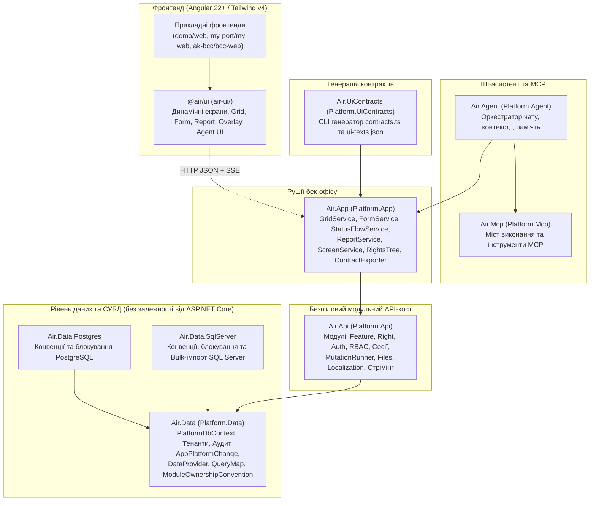

# Документація платформи Air (`air-platform`)

Ласкаво просимо до документації **Air Platform** — високошвидкісної декларативної платформи для побудови корпоративних вебзастосунків, ERP/CRM/E-commerce систем і бек-офісів на стеку **.NET 10 (C# 14)** та **Angular 22+ (Signals, Tailwind CSS v4, Nx)**.

Цей розділ створено для розробників, які підключаються до розвитку платформи або створюють на її базі прикладні системи (`demo`, `my-port`, `ak-bcc`).

---

## Зміст документації

1. **[Огляд платформи та канонічні принципи (цей документ)](#1-філософія-та-ключова-ідея-платформи)** — як мислить платформа, з яких проєктів вона складається та які 8 архітектурних законів (ADR) у ній діють.
2. **[Архітектура ядра: Дані, Безпека, RBAC, Мутації та API (`docs/architecture.md`)](./architecture.md)** — детальний розбір `Air.Data` (сутності, мульти-тенантність, аудит `AppPlatformChange`, блокування, `DataProvider`, `QueryMap`) та `Air.Api` (модулі, `Feature`, модель прав `CanView`/`CanEdit`, сесії, `MutationRunner`, файли, локалізація).
3. **[Рушії інтерфейсу, `@air/ui` та ШІ-асистент (`docs/ui-engines-and-agent.md`)](./ui-engines-and-agent.md)** — практичний довідник із `GridService`, `FormService`, `StatusFlowService`, `ReportService`, `ScreenService`, `FileGridService`, бібліотеки компонентів `@air/ui` та декларативного ШІ-асистента `Air.Agent`.
4. **[Посібник зі створення нового застосунку та модуля (`docs/new-app-guide.md`)](./new-app-guide.md)** — покроковий чекліст розгортання нового репозиторію або модуля (`*.Data`, `*.Migrations`, `*.Api`, хост, фронтенд і контракти).
5. **[Робочий процес, порти, перевірки якості та Git (`docs/workflow-and-git.md`)](./workflow-and-git.md)** — команди `Makefile` (`make format`, `make gate`, `make contracts`, `make audit`), розподіл портів IDE та Агента, стандарти коду й комітів.

---

## 1. Філософія та ключова ідея платформи

У традиційній веброзробці кожен новий довідник або документ вимагає написання десятків файлів: EF-конфігурацій, DTO, контролерів, валідаторів, сервісів, клієнтських моделей, HTML-шаблонів таблиць і форм, модальних вікон, фільтрів та інтеграції з ШІ.

**Air Platform вирішує це радикально інакше:**

- **100% декларативні метадані на бекенді:** Розробник описує сутність БД (`C# class`), реєструє фічу (`Feature`) у модулі та створює компактні класи сервісів (`*GridService`, `*FormService`, `*FlowService`), де декларативно вказує колонки, поля форми, вкладки, зв'язки (`AsReference`, `AddChild`, `PatchOnSelect`), умови доступності (`DisabledWhen`, `VisibleWhen`) та переходи статусів.
- **Універсальний клієнтський рушій (`@air/ui`):** Фронтенд не містить жодної жорстко закодованої бізнес-форми чи таблиці. Він запитує метадані екрана (`ScreenDto`) у бекенду й автоматично будує таблиці з віртуальним скролом, фільтрами, сортуванням, експортом у Excel, багатосекційні форми-дровери, дерева прав та аналітичні звіти.
- **Вбудований ШІ-асистент без ручних хендлерів (`Air.Agent`):** Достатньо додати `.AllowAgent()` до оголошення фічі — і ШІ-асистент автоматично прочитає схему форми, довідники, дочірні таблиці та права поточного користувача, формуючи безпечні картки пропозицій `<air_proposal>`, які проходять через той самий конвеєр валідації та збереження `FormService`, що й звичайні дії користувача в UI.

---

## 2. Карта проєктів платформи

| Проєкт (`src/`)          | Простір імен C#             | Призначення                                                                                                                                                                                                                                                                         |
| :----------------------- | :-------------------------- | :---------------------------------------------------------------------------------------------------------------------------------------------------------------------------------------------------------------------------------------------------------------------------------- |
| **`Air.Data`**           | `Platform.Data.*`           | Базовий `PlatformDbContext` (EF Core 10), мульти-тенантність, автоматичний журнал змін `AppPlatformChange`, ізоляція схем модулів (`[ModuleSchema]`), рушій запитів і проєкцій (`DataProvider<TEntity, TRow>`, `QueryMap`). **Не має залежностей від ASP.NET Core.**                |
| **`Air.Data.Postgres`**  | `Platform.Data.Postgres.*`  | Провайдер PostgreSQL: `snake_case` іменування, песимістичні блокування (`FOR UPDATE` + `lock_timeout`).                                                                                                                                                                             |
| **`Air.Data.SqlServer`** | `Platform.Data.SqlServer.*` | Провайдер MS SQL Server: конвенції типів, песимістичні блокування (`UPDLOCK, ROWLOCK`), пакетний імпорт.                                                                                                                                                                            |
| **`Air.Api`**            | `Platform.Api.*`            | Легковаговий headless API-хост: життєвий цикл модулів (`IPlatformModule`, `Feature`, `Right`), автентифікація, сесії, RBAC (`GrantedRights`, `HeldRights`), мутації (`MutationRunner`, ідемпотентність), файли (`FileLinks`), локалізація та універсальний HTTP-диспетчер сервісів. |
| **`Air.App`**            | `Platform.App.*`            | Повнофункціональний рушій бек-офісу поверх `Air.Api`: `GridService`, `FormService`, `StatusFlowService`, `ReportService`, `ScreenService`, `FileGridService`, `ChangeGridService`, дерево прав `RightsTree`, оверлеї та експортер TypeScript-контрактів `ContractExporter`.         |
| **`Air.Mcp`**            | `Platform.Mcp.*`            | Протокол MCP та ізольований міст виконання `McpExecutionBridge` між ШІ-провайдером і процесом платформи.                                                                                                                                                                            |
| **`Air.Agent`**          | `Platform.Agent.*`          | Вбудований ШІ-асистент: збір метаданих і довідників з урахуванням прав користувача, побудова та виконання карток `<air_proposal>`, довготривала пам'ять `AppAgentMemory`, CLI/API провайдери (`agy`, `claude`, `codex`, `gemini`).                                                  |
| **`Air.UiContracts`**    | `Platform.UiContracts`      | CLI-інструмент для миттєвої генерації `contracts.ts`, `endpoints.ts` та `ui-texts.json` у `@air/ui`.                                                                                                                                                                                |
| **`air-ui/`**            | `@air/ui` (TypeScript)      | Універсальна бібліотека Angular 22+ компонентів, сервісів і семантичних токенів Tailwind CSS v4.                                                                                                                                                                                    |

> [!NOTE]
> **Нейтральність бренду в коді (`Platform.*`):** Слово `Air` використовується лише в назвах `.csproj` / `.slnx` файлів. Усі простори імен C# використовують префікс `Platform.*` (`Platform.Data`, `Platform.Api`, `Platform.App`, `Platform.Agent`, `Platform.Mcp`), що забезпечує прозору модульність і легке перевикористання.

---

## 3. Вісім канонічних законів архітектури (ADR #1–#8)

Усі рішення в платформі та прикладних системах спираються на 8 незмінних інваріантів:

1. **Чітке розділення `Air.Api` та `Air.App` (ADR #1):**
   `Air.Api` — це чистий headless API-хост (який можна використовувати окремо для публічних чи зовнішніх API без UI-рушіїв), а `Air.App` надбудовує над ним рушії бек-офісу (`GridService`, `FormService`, `ReportService`, `StatusFlowService`).
2. **Власний модуль `App` у кожному застосунку (`DemoApp`, `MyApp`, `BccApp`) (ADR #2):**
   Кожен застосунок має власний базовий модуль `App` (користувачі, ролі, сесії, налаштування), щоб специфічні для конкретного бізнесу поля користувача чи організації (наприклад, прив'язка до співробітника складу `EmployeeId` в Автокладі) ніколи не протікали в інші застосунки.
3. **Явна властивість `public override Feature Feature => ...` у кожному сервісі (ADR #3):**
   Кожен сервіс грида, форми, звіту чи статусного потоку явно оголошує свою `Feature`. Розробник одразу бачить у коді сервісу, до якої фічі та області прав RBAC він належить, не шукаючи реєстрації по всьому проєкту.
4. **Базові сервіси модуля та правило «1 набір сервісів на кожну `Feature`» (ADR #4):**
   - Одиницею прав доступу (RBAC), маршрутизації меню та ізоляції бізнес-логіки є **`Feature`**, а не таблиця БД.
   - Навіть якщо 11 видів документів зберігаються в одній таблиці БД (як `EcomDoc` у `DemoEcom`), кожна `Feature` обов'язково має власні конкретні класи `*GridService`, `*FormService`, `*FlowService` в окремих файлах. Спільна логіка виноситься в абстрактні базові класи, але конкретні класи фіч ніколи не видаляються.
   - У кожен сервіс інжектується контекст модуля (`AppService app`, `FinAppService app` тощо), а перевірка прав завжди пишеться лаконічно: `app.Can(Fin.BankSync.Edit)`.
5. **Окремі збірки міграцій `*.Migrations.csproj` (ADR #5):**
   Міграції EF Core (з багатотисячними файлами `*ModelSnapshot.cs`) та початкові дані (`Seeds`) завжди живуть в окремих проєктах `*.Migrations.csproj`, щоб не обтяжувати компіляцію та залежності `*.Data`.
6. **Конвенція файлів і просторів імен JetBrains Rider (ADR #6):**
   Суворе правило **«1 тип = 1 файл»**. Простір імен (`namespace`) кожного `.cs` файлу точно відповідає його фізичному шляху відносно кореня проєкту (включно з папками `Contracts/` та `Internals/`). При цьому простори імен `*.Internals` ніколи не додаються у `GlobalUsings.cs` — вони підключаються локальним `using ...Internals;` лише там, де потрібні.
7. **Збереження `Air.Mcp` та провайдерів `Air.Agent` (ADR #7):**
   Платформа підтримує як вбудовані CLI/API провайдери (`agy`, `claude`, `codex`, `gemini`), так і `Air.Mcp` для зовнішніх інтеграцій.
8. **Канонічний закон ізоляції модулів (ADR #8):**
   - **Один самодостатній `*DbContext` на модуль:** Ланцюжок спадкування контекстів іде строго вертикально (`PlatformDbContext` → `AppDbContext` → `OrgDbContext` → `EcomDbContext`). Сервіс ніколи не шукає «чужий `DbContext`». Якщо модулю рідко потрібна таблиця з паралельного модуля, він додає `DbSet<TEntity>` у свій `DbContext` — `ModuleOwnershipConvention` за атрибутом `[ModuleSchema]` автоматично визначить модуль-власник і виключить чужу таблицю з міграцій поточного модуля.
   - **Суворо вертикальне використання сервісів:** Сервіс у модулі `M` може посилатися (`AsReference`, `AddChild`, `Parent.Bind/Read`, `Nav.AddCreate`, `FlowOf`, `AddFollower`, `AsOpenForm`, `AsCover`, `PickedBy`) **виключно** на сервіси самого модуля `M` або базових модулів у ланцюжку спадкування його `DbContext` (перевіряється автоматично через `ModuleCatalog.EnsureModuleServiceAccessAllowed`). Горизонтальні зв'язки між паралельними модулями (`Crm` ↔ `Fin`) заборонені — це гарантує незалежну командну розробку та відсутність витоків прав доступу.
